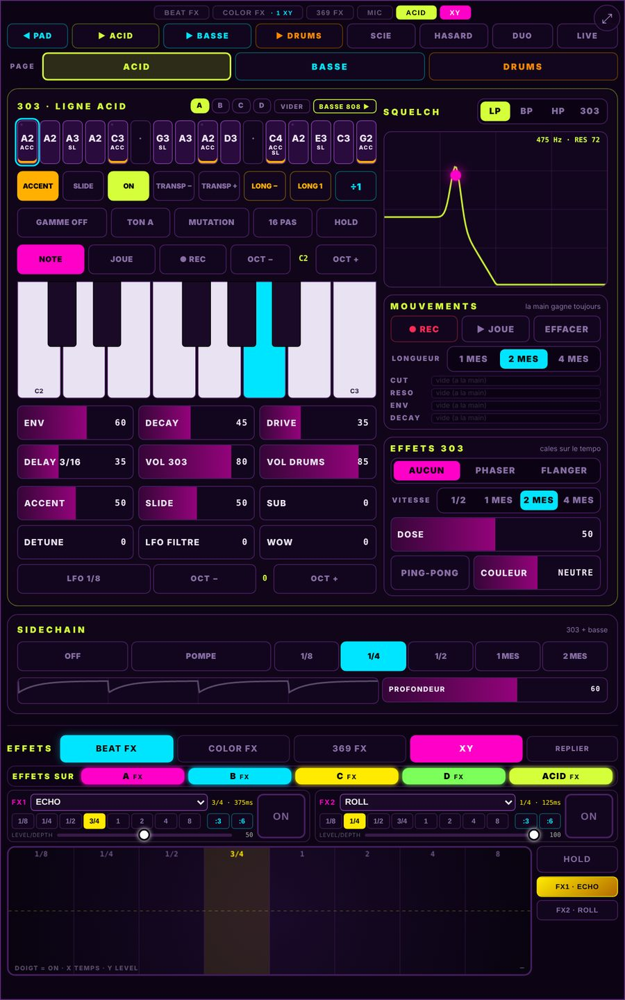
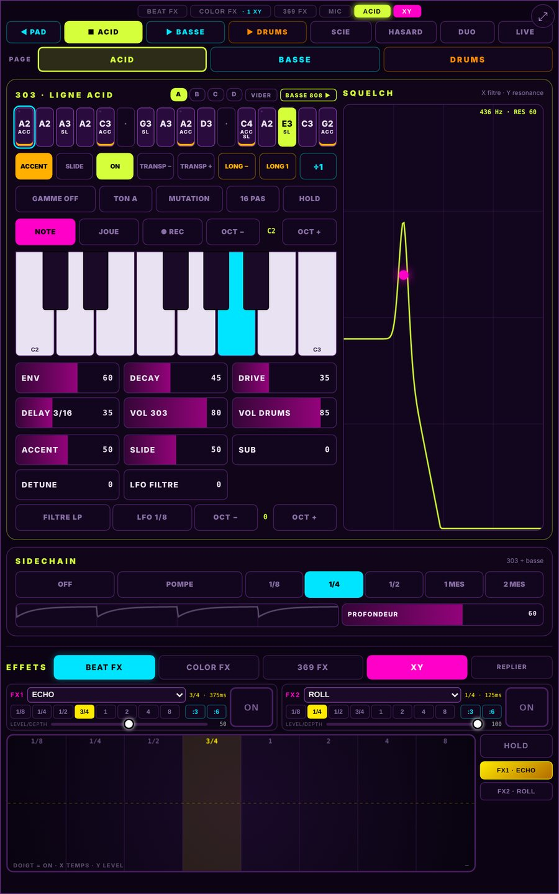
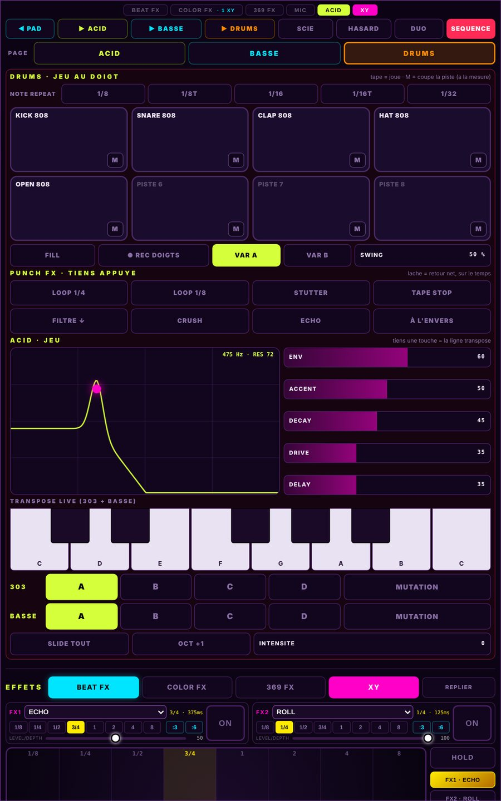

# ◆ 369 LAUNCHPAD · Nouveautés ◆

**The Stoned Psylosopher · The Strange 369 Project**

*Le journal public des avancées. Le code source reste privé.*
*Public progress log. The source code stays private.*

---

## Novembre 2026

### v36.51 · 13 novembre · le synthé ACID grandit, effets par deck
- Un **filtre « 303 »** à diodes, 24 dB, à côté de LP, BP et HP, choisi dans le titre du SQUELCH. La résonance crie et mange les graves, comme sur la vraie machine, sans jamais partir en sifflement sans fin. Il est réglé pour avoir la même brillance et le même volume que le LP : on entend le caractère, pas le volume.
- **WOW** : des accents qui se suivent font monter le filtre de plus en plus, puis il redescend après le groupe.
- **MOUVEMENTS** : on appuie sur REC, on tourne le filtre, la résonance, l'enveloppe ou le decay pendant 1, 2 ou 4 mesures, et l'ACID rejoue les gestes en boucle. La main reprend la main dès qu'elle touche.
- **EFFETS 303** : PHASER et FLANGER calés sur le tempo, avec leur dose, un delay **PING-PONG** et sa **COULEUR** (sombre ↔ fin).
- **EFFETS SUR : A B C D ACID** : chaque deck, et l'ACID, passe dans les effets ou reste **sec**. Exemple : le deck des kicks reste sec, le reste part dans l'écho.
- Par défaut, rien ne change : le son est mesuré identique à la v36.50 tant qu'on ne touche pas aux nouveaux boutons.

  

### v36.50 · 12 novembre · LOOP qui suit, STOP général, boutons ACID / BASSE / DRUMS
- **LOOP** : elle **suit** maintenant les changements. On lance une séquence ou un pad pendant la LOOP, on l'entend à son temps, puis la LOOP repart avec lui. Avant, la nouvelle séquence restait cachée derrière la boucle.
- **■ STOP** du PAD arrête **tout**, l'ACID compris, sur tous les appareils.
- **Plus de bouton PLAY** dans l'ACID : on lance chaque partie avec **ACID**, **BASSE** ou **DRUMS**. Depuis l'arrêt, la partie touchée part seule ; quand la dernière s'éteint, tout s'arrête.
- **SCRATCH retiré** : il ne servait pas en live.
- Un rapport mesuré sur la page **LIVE DRUMS** (9 points à améliorer) prépare les prochaines retouches.

  
  &nbsp;
  

### v36.49 · 7 novembre · l'ACID sur la tablette debout
- Chaque page (**ACID**, **BASSE**, **DRUMS**) dans un cadre à sa couleur, avec des tailles régulières : pas, clavier, faders et cases plus grands.
- Les réglages et la piste choisie sont ouverts d'office, et le XY prend le reste de l'écran : plus de vide en bas.
- Corrigés : **TAPE STOP** repris très vite (son doublé), et un double coup au départ du **NOTE REPEAT**.

### v36.48 · 4 novembre · pages ACID / BASSE / DRUMS, filtre DJ, gestes par page
- L'ACID se range en **3 pages**. Sur la tablette, **DUO** montre tout, comme avant.
- **FILTRE DJ** des DRUMS : à gauche passe-bas, à droite passe-haut, deux tapes pour revenir au milieu.
- Sur le téléphone, **le GESTE suit la page** : en DRUMS, pencher joue le filtre DJ et le swing, secouer lance un FILL ; en BASSE, pencher joue la coupure et le LFO, lever monte d'une octave.
- Premier **SCRATCH** sur le PAD (retiré en v36.50).
- Corrigé : une LOOP choisie puis coupée avant son départ pouvait rester coincée.

### v36.47 · 3 novembre · les effets sous l'ACID, BPM à plusieurs
- **EFFETS en bas de l'ACID** en plein écran : BEAT FX, COLOR FX, 369 FX et le XY, sans quitter l'ACID.
- **BPM à plusieurs appareils** : le dernier qui change le tempo gagne. Deux fondus en même temps ne restent plus bloqués à des tempos différents.
- Le DUO harmonisé : les colonnes finissent à la même hauteur et tout tient sur l'écran.

### v36.46 · 31 octobre · ACID LIVE, PUNCH FX, LOOP du PAD
- **ACID en plein écran** sur la tablette, et une page **LIVE** pour jouer :
  - **DRUMS au doigt** : 8 pads, NOTE REPEAT (1/8 à 1/32, triolets), coupure de piste à la mesure, FILL tenu, REC DOIGTS, variations A / B, SWING ;
  - **8 PUNCH FX** tenus : LOOP 1/4, LOOP 1/8, STUTTER, TAPE STOP, FILTRE, CRUSH, ÉCHO, À L'ENVERS ;
  - **ACID au doigt** : squelch, faders, TRANSPOSE LIVE de la 303 et de la basse, octave, slide, motifs, mutation, intensité.
- **GESTE++** sur le téléphone : pencher, bouger vite, secouer, lever d'un coup… chaque mouvement joue quelque chose.
- **LOOP du PAD** : 16 à ½ temps, avec les effets par-dessus. La musique reprend là où elle en serait.
- **BPM** : bandeau **SON EN PAUSE** (un doigt relance le son) et un **journal du BPM**.

## Octobre 2026

### v36.45 · 30 octobre · DRUMS : 8 pistes de samples, triolets et découpes en 6
- La 808 synthétique laisse la place à **DRUMS** : **8 pistes de samples**, 16 pas chacune. Au départ, les 5 premières pistes contiennent un **KIT 808** : les mêmes sons qu'avant, rendus en samples, au même volume.
- **CHARGER** : plusieurs fichiers ou un **dossier entier** d'un coup. Les samples remplissent les pistes dans l'ordre de leurs noms (« 2 » passe avant « 10 »).
- **Un effet par piste** : on touche le nom de la piste, on choisit **DIST, COMP, REVERB, DELAY, F.BAS, F.HAUT** ou **CRUSH**, avec son **dosage**, plus un **PITCH** de ±12 demi-tons. À dosage 0, le son reste intact.
- **Découpes** : une case de DRUMS joue 1, 2, **3 (triolet)**, 4 ou **6** coups. Le bouton **÷** découpe aussi les notes du 303 et de la basse. Les roulements tombent pile sur la grille.
- **+ RÉGLAGES 303** : accent, slide, **SUB**, **DETUNE**, LFO du filtre calé sur le tempo, filtre **LP / BP / HP**, octave.
- **+ RÉGLAGES BASSE** : boum, attaque, glide, coupure, résonance, octave.
- 📷 [Les panneaux de réglages](captures/acid_reglages_v36.45.jpg)

### v36.44 · 26 octobre · premier DRUM RACK
- **8 lignes de samples** sous la 808, 16 pas chacune, avec les samples des pads ou des fichiers audio.
- Chaque ligne coupe sa note d'avant, sans clic. Au rechargement, une ligne **retrouve son sample par son nom**.

### v36.43 · 26 octobre · notes longues, motifs, gamme
- **Notes longues** pour le 303 et la basse : une note tient de 1 à 16 pas.
- **4 motifs (A, B, C, D)** par instrument. En PLAY, le changement tombe pile à la mesure.
- **GAMME** : HASARD et **MUTATION** restent dans la gamme choisie. Chaque ligne peut avoir sa propre longueur de motif.
- Panneau **LIVE** à gros boutons : **FILL** sur le dernier temps, et **INTENSITÉ**, qui ouvre le filtre et monte l'enveloppe, la saturation et le delay ensemble.
- Le piano tient la note tant que le doigt reste posé (ou toujours, avec **HOLD**).

### v36.42 · 24 octobre · plusieurs doigts, DUO, nouvelles formes d'onde
- **2, 3 ou 4 doigts à la fois** sur la tablette, le téléphone et ACID : on tient un fader et on tape des pas en même temps.
- **DUO** sur la tablette : la basse à gauche, le 303 à droite, la boîte à rythmes dessous.
- **Nouvelles formes d'onde** : **PULSE** pour le 303 ; **SIN+OCT** (elle s'entend même sur un petit haut-parleur) et **CARRÉ ROND** pour la basse. Même volume perçu, mesuré en LUFS.
- Styles de beat **AMEN** (le break des Winstons) et **DRILL PSY**.
- Un effet sous chaque voix de la 808 : distorsion, compression, reverb, delay.
- **LFO JUNGLE** sur la basse : le filtre ondule sur les temps (de 1/4 à 1/16T), calé sur la grille. En JAM, tous les appareils ondulent ensemble.
- Corrigés : un petit clic avant chaque note de basse, et des premières notes trop fortes au démarrage.

### v36.40 → v36.41 · 24 octobre · la BASSE 808 et le SIDECHAIN
- **BASSE 808** : 16 pas, un sinus saturé avec un petit « boum », GLIDE, DECAY, DRIVE, et un piano de 2 octaves. Sur le téléphone, la page BASSE passe à l'horizontale.
- **STYLES** HOUSE, TECHNO, TRAP, BREAK : un nouveau beat à chaque appui.
- **SIDECHAIN** sur le 303 et la basse : 4 formes, de 1/8 à 2 mesures, calé sur la grille. En JAM, tout le monde pompe ensemble.

### v36.39 · 23 octobre · ACID au geste en 3 dimensions, la voix protégée
- 🎬 **[La vidéo](video/369_LP_ACID_v36.39.mp4)** : la tablette, les téléphones et 369 ACID, en live.
- **Axe Z dans ACID** : en mode **GESTE**, un bouton **Z** remplace le fader ENV. Z allumé : on **tourne le téléphone** comme une poignée et l'enveloppe de la 303 suit (le « wouaou »). Z éteint : la valeur reste **verrouillée**, on peut danser et se retourner sans rien dérégler.
- **Pencher, en beaucoup plus précis** : le filtre (avant / arrière) et la résonance (gauche / droite) se lisent maintenant sur le gyroscope. Le filtre répond **environ 4 fois plus vite**, et rien ne bouge tout seul quand on danse ou qu'on secoue.
- **Plus de larsen par le mauvais micro** : si Android donne le micro du téléphone au lieu du micro branché dans le jack, la voix **ne part plus vers la sono**. Le vu-mètre continue de montrer ce que le micro du téléphone entend, et une alerte l'explique. Un bouton permet de l'utiliser quand même.
- **Un bouton pour sortir du plein écran** : changer d'application en un seul glissé, et la page se reverrouille en vertical au prochain appui.
- **Sortie MONO retirée** : la sortie de la tablette reste toujours en stéréo.

### v36.38 · 23 octobre · anti-larsen grave, table de mixage, dossiers
- L'anti-larsen surveille maintenant **de 90 à 12 000 Hz** et coupe en un quart de seconde. Il attrape aussi le **larsen grave** (le « wouuu » vers 120 Hz), qui passait sous le radar.
- Le panneau jack affiche le **micro réellement utilisé** par Android.
- **TEST 1k** : un son de référence pour régler le gain d'une **table de mixage** branchée sur le jack de la tablette.
- **DOSSIER** : on charge un **dossier entier** de samples d'un coup (Chrome Android récent, avec le support des dossiers), ou quelques fichiers avec **FICHIERS**.

### v36.37 · 22 octobre · la scène, et un petit piano
- **Petit piano** dans ACID : on écrit les notes pas à pas, ou on joue en direct, avec **REC** pour enregistrer pendant que ça tourne. **TRANSPOSE** décale toute la ligne.
- Mode **SCÈNE** pour la voix : expandeur et compression, la voix reste devant même avec la sono à fond.
- Les échos de la voix sont **décalés de 3 Hz en fréquence** : la boucle sono → micro ne peut plus « accrocher ». La voix directe, elle, reste juste.
- L'écran **reste allumé** et la page **ne tourne plus** (tablette et téléphones).
- Le vocodeur se relance tout seul s'il cale (trou de Wi-Fi, mise en veille).

### v36.36 · 22 octobre · 369 ACID, la 303 et la 808
- Nouvel instrument **369 ACID** : une **303** (16 pas, accent, slide, dent de scie ou carré, filtre résonant) et une **808** (kick, snare, clap, hats), fabriquées en direct, sans sample, calées sur le tempo du launchpad.
- Jouable sur la tablette (onglet ACID) ou sur un téléphone : en télécommande de la tablette, ou en local avec **SON : ICI**.
- Pad **SQUELCH** (filtre + résonance au doigt), **delay 3/16** en ping-pong, bouton **HASARD**.
- **GESTE** : pencher le téléphone joue le filtre, le secouer lance un coup de synthé.

### v36.35 · 21 octobre · premier anti-larsen
- **Anti-larsen** sur la voix : 6 filtres très fins qui se posent tout seuls sur un sifflement, et un **gain auto** s'il insiste.
- Les échos de la voix ne remontent plus le bruit de la salle : fini les résonances qui bouclent.
- Porte du micro : bouton **CALER** (2 secondes de silence, et le seuil se règle tout seul). Gain du micro jack de **-24 à +24 dB**.

### v36.34 · 19 octobre · sécurité, retour casque, JAM plus clair
- **Clé de session** : au lancement, le serveur affiche une clé. Seuls les appareils qui l'ont peuvent se relier au launchpad. Personne d'autre sur le même Wi-Fi ne peut piloter ni écouter le mix.
- **Retour casque** sur le téléphone : **SONO** (le jack est la sortie principale), **RETOUR** (la tablette joue sur la sono, le casque reçoit une copie) ou **RETOUR N-1** (la copie *sans ta voix* : plus d'écho de ta propre voix dans le casque).
- **JAM** : le bouton du suiveur dit clairement **SON : PAR LE MAÎTRE** ou **SON : CHEZ MOI**. En « par le maître », les **effets** de l'invité (XY, BEAT FX, 369 FX) s'entendent aussi sur la tablette maître.

### v36.33 · 17 octobre · la prise jack du téléphone, dans les deux sens
- Au choix : **OFF / SORTIE / ENTRÉE / LES 2**.
- **ENTRÉE** : un micro branché dans le jack du téléphone part droit dans le **vocodeur** et les effets de la tablette. Testé avec un micro JBL, reconnu tout seul.
- Gain du micro réglable, anti-saturation douce, vu-mètre, micro branché ou débranché en plein jeu suivi automatiquement.

### v36.32 · 17 octobre · un son plus stable
- **Beaucoup moins de crépitement** : les boucles sont programmées plus tôt, et un départ en retard repart au bon endroit du sample, sans clic.
- Choix **SON RAPIDE / NORMAL / SÛR** selon la puissance de la tablette.
- Changements de **BPM** et de **deck** : les boucles restent calées.

### v36.29 → v36.31 · 17 octobre · JAM à plusieurs appareils
- Rôles choisis : **MAÎTRE / SUIVEUR / OFF**. Le dernier maître choisi garde la main.
- **Une seule sortie** : le son des invités sort du maître, ou de la tablette de son choix (**SORTIE : COMMANDE**).
- Le téléphone en mode PAD se relie tout seul au serveur.

### v36.28 · 17 octobre · la grande refonte
- **SON ICI** : tout le mix peut sortir par le **jack du téléphone**, vers la sono.
- Onglet **MIC** sur la tablette, avec une porte de bruit sélective.
- Voix : mode **PUR** (à peine travaillé), delay sur la voix calé sur le tempo avec **reverb**, fader **REVERB VOIX**.
- **ROLL** en triolets (**:3 / :6**).
- **STUTTER** avec plusieurs roulements (**1/4, :6, 1/8, 1/16, ACCEL**) sur un fader.
- **DROP** : un **vrai silence** de 1 à 4 temps, puis l'impact.
- Les boutons FX au-dessus des colonnes envoient vraiment *seulement* ces colonnes dans les effets.

### v36.21 → v36.27 · 14 → 17 octobre · le mix
- Chaque **deck a son fader**, directement dans sa case, comme sur une table de mixage. Le crossfader a été retiré : plus simple, plus direct.
- L'**électricité** dans les cases suit le volume réel de chaque deck.
- **BPM PROGRESSIF** (le tempo glisse sur 16 temps) ou **DIRECT**.
- Un **camembert** dans chaque pad montre où en est la boucle.
- **3 nouveaux 369 FX** : **RISE PUMP, REFLECT ECHO, MULTI DELAY** (9 effets maison au total, jusqu'à 3 empilés).

### v36.19 → v36.20 · 12 → 13 octobre · caméra et voix
- **Caméra** : vraie reconnaissance de la main, sans internet.
- Voix : modes **SYNTH** et **PITCH**, 369 FX empilables avec un réglage d'**IMPACT**.

---

## 🔭 En préparation
- Une **appli Android** : tout lancer d'un seul geste.
- *(Le synthé 303 et le squelch au geste sont arrivés : voir v36.36 → v36.39.)*

---

## English (short)

- **v36.51**: a diode-ladder **"303" filter** (24 dB, next to LP / BP / HP), matched in brightness and loudness so you hear the character, not the level. **WOW**: accents in a row push the filter higher and higher. **Motion recording**: hit REC, turn cutoff, resonance, envelope or decay for 1, 2 or 4 bars, and the 303 plays your moves back in a loop (your hand always wins). **303 effects**: tempo-synced phaser and flanger, ping-pong delay with a dark-to-bright colour. **Effects per deck**: each deck (A, B, C, D) and the ACID can go through the effects or stay dry.
- **v36.50**: the LOOP now follows sequence changes, STOP stops everything, ACID / BASSE / DRUMS buttons start each part (no more PLAY), SCRATCH removed.
- **v36.46 → v36.49**: full-screen ACID with a **LIVE** page (finger drums with note repeat, 8 held punch effects, live transpose), effects under the ACID, multi-device tempo, ACID / BASS / DRUMS pages with a DJ filter and per-page phone gestures, framed pages on a portrait tablet.
- **v36.45**: the synthesized 808 makes way for **DRUMS**, an **8-track sample drum machine** (an 808 kit rendered as samples is loaded by default, or load your own files or a whole folder). One effect per track (distortion, compression, reverb, delay, low-pass, high-pass, bitcrusher) with its own amount and pitch. Steps and notes can be split into 2, 3 (**triplets**), 4 or 6 hits. New **303** settings (sub, detune, synced filter LFO, LP / BP / HP filter, octave) and **bass** settings (boom, attack, glide, cutoff, resonance, octave).
- **v36.44**: a first 8-line sample drum rack under the 808.
- **v36.43**: long notes, 4 patterns per instrument (switching exactly on the bar), scale-locked random and mutation, a LIVE panel with FILL and INTENSITY.
- **v36.42**: **multi-touch** (2 to 4 fingers at once), DUO layout (bass left, 303 right, drums below), new waveforms (PULSE, SIN+OCT, ROUNDED SQUARE) matched in loudness, AMEN and DRILL PSY beats, per-voice drum effects, a tempo-synced **jungle LFO** on the bass.
- **v36.40 → v36.41**: an **808-style bass** (16 steps, glide, drive, 2-octave piano), one-tap beat styles, a tempo-locked **sidechain** that pumps in sync across all JAM devices.
- **v36.39**: **369 ACID in 3D**: tilt for filter and resonance (gyroscope-based, about 4x faster), twist the phone for the envelope (**Z axis**, lockable), shake for a synth hit. The voice stream is blocked if Android silently swaps the jack mic for the phone's own mic (a button lets you force it anyway). Fullscreen exit button: one swipe to switch apps. The MONO output is gone: always stereo.
- **v36.38**: wide-band anti-feedback (90 Hz - 12 kHz, catches low howls), the real mic in use shown in the jack panel, a 1 kHz reference tone for mixing desks, whole-folder sample loading.
- **v36.37**: a tiny piano with REC in ACID, SCENE mode for the voice, voice echoes frequency-shifted by 3 Hz against feedback, screen always on and portrait-locked.
- **v36.36**: **369 ACID**: a 303 bassline and an 808 drum machine, synthesized live, tempo-locked, playable from the tablet or a phone.
- **v36.35**: first automatic anti-feedback (6 narrow notch filters), one-tap noise gate calibration.
- **v36.34**: session key (only devices with the key shown at startup can connect); headphone return with an **N-1** option (the mix *without your own voice*); JAM guests' effects now play through the master.
- **v36.33**: the phone's jack works both ways. Plug a mic into it and your voice goes straight into the tablet's vocoder.
- **v36.32**: much steadier sound (far less crackling), with a choice of output buffer size.
- **v36.28 → v36.31**: whole mix out of the phone's jack, tablet mic tab, triplet rolls, multi-speed stutter, true-silence drop, clear MASTER / FOLLOWER roles in JAM.
- **v36.19 → v36.27**: hand tracking camera, one fader per deck (no more crossfader), smooth or instant BPM changes, 3 new custom 369 FX.
- **Coming next**: an Android app.

---

**Code source privé : tous droits réservés.** · *Source code is private. All rights reserved.*

**@the_stoned_psylosopher** · © 2026 The Stoned Psylosopher · The Strange 369 Project

