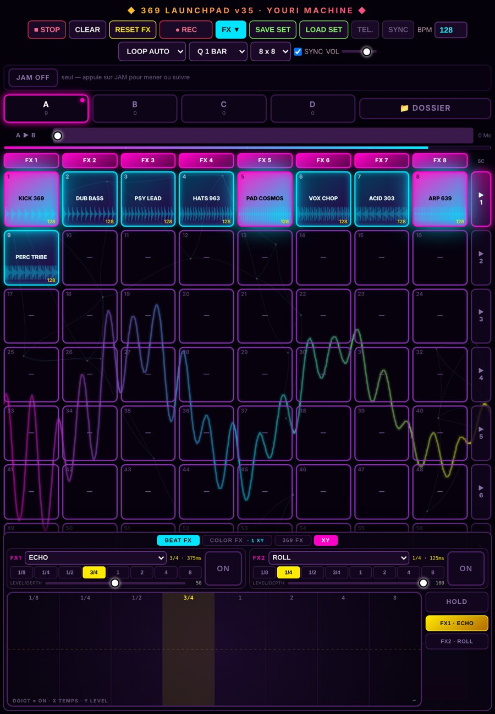
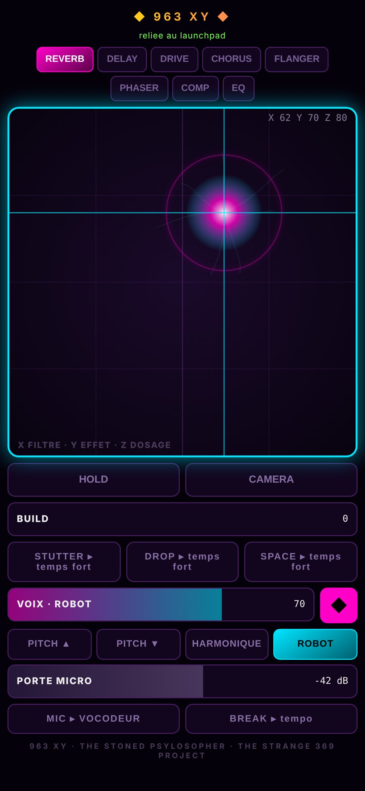
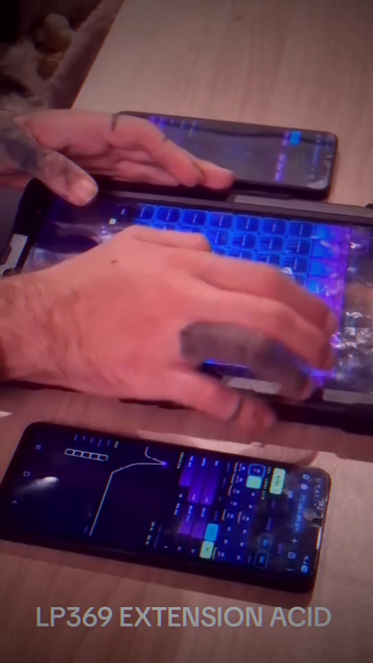

# ◆ 369 LAUNCHPAD ◆

**The Stoned Psylosopher · The Strange 369 Project**

*Un launchpad audio live, qui tourne dans le navigateur d'une tablette, avec le téléphone comme télécommande.*
*A live audio launchpad running in a tablet's browser, with your phone as the remote.*

[Instagram @the_stoned_psylosopher](https://www.instagram.com/the_stoned_psylosopher/) · **[📰 Nouveautés / What's new](NOUVEAUTES.md)**

---

  
  &nbsp;
  

## 🎛️ La tablette : 369 LAUNCHPAD

- **4 decks (A · B · C · D)** de pads, tous calés sur la même grille de tempo, chacun avec **son fader** directement dans sa case, comme sur une table de mixage
- **Boucles calées sur le BPM**, quantisées à la mesure, une seule case par colonne, avec un camembert qui montre où en est chaque boucle
- **BPM PROGRESSIF** (le tempo glisse sur 16 temps) ou **DIRECT**
- **3 familles d'effets** :
  - **COLOR FX** : 8 effets pilotés au doigt sur un pad XY, envoyés seulement sur les colonnes choisies
  - **BEAT FX** : effets rythmiques au tempo (echo, roll avec triolets…)
  - **369 FX** : 9 effets maison qui bougent en rythme, GATE 369, PUMP, CRUSH, SWELL ECHO, SHIFT 369, WARP, RISE PUMP, REFLECT ECHO et MULTI DELAY, jusqu'à 3 empilés
- **Macros de live** : BUILD, DROP (un vrai silence de 1 à 4 temps, puis l'impact) et STUTTER (plusieurs roulements, jusqu'à l'accélération), toutes sur le temps fort
- **Onglet MIC** : le micro de la tablette, avec une porte de bruit sélective
- **Réseau neuronal visuel** qui s'allume à chaque pad, et une électricité dans les cases qui suit le volume de chaque deck

## 📱 Le téléphone : 963 XY

- **Pad XY** pour piloter les effets de la tablette à distance
- **Mode CAMÉRA** : la main au-dessus du téléphone devient le doigt (vraie reconnaissance de la main, sans internet), et plus la main s'approche, plus l'effet monte
- **VOIX** : le micro du téléphone, transformé et joué par la tablette, en **PUR**, **ROBOT**, **HARMONIQUE**, **SYNTH**, **PITCH ▲** ou **PITCH ▼**, avec une porte de bruit réglable et une **reverb** dosable. BUILD fait monter un écho calé sur le tempo.
- **La prise JACK, dans les deux sens** : le mix peut **sortir** par le jack vers la sono, ou un micro branché dans le jack peut **entrer** dans le vocodeur. Il y a aussi un **retour casque**, avec ou sans ta propre voix.

## 🔗 JAM : plusieurs appareils, un seul son

- Plusieurs tablettes et téléphones se calent sur le **même tempo**, réglé par le **maître**
- Mode **« son par le maître »** : chaque invité devient une télécommande. Ses samples partent une fois vers le maître, puis tout sort d'une **seule enceinte**, calé sur la grille, **effets compris**. On peut jouer jusqu'à **4 personnes**.
- **Clé de session** : seuls les appareils qui ont la clé affichée au lancement peuvent se joindre au jam.

## 🎬 Démo

  
   
  <a href="video/369_LP_ACID_v36.39.mp4"><b>▶ Regarder la vidéo / Watch the video</b></a> · tablette + 963 XY + 369 ACID, en live (v36.39)

---

## English

**369 LAUNCHPAD** is a live performance instrument built for the browser.

- **On the tablet**: 4 decks of tempo-synced loops with one fader per deck, three effect families (including 9 custom rhythmic **369 FX**), live macros (build, a true-silence drop, multi-speed stutter) and a mic tab.
- **On the phone (963 XY)**: an XY remote with a **camera mode** (your hand becomes the finger) and a **voice mode** (pure, robot, harmonic, synth or pitch-shifted vocals played by the tablet). The phone's **jack works both ways**: the whole mix out to a speaker, or a mic in, straight into the vocoder, with a headphone return that can leave out your own voice.
- **JAM mode**: several devices share one tempo set by the master. In "master output" mode, everyone's pads *and effects* play through a single speaker. A **session key** keeps strangers out.

See **[NOUVEAUTES.md](NOUVEAUTES.md)** for the full progress log.

---

**Code source privé : tous droits réservés.**
*Source code is private. All rights reserved.*

Pour une collaboration, une démo ou une performance / For collaborations, demos or live shows:
**@the_stoned_psylosopher**

© 2026 The Stoned Psylosopher · The Strange 369 Project

